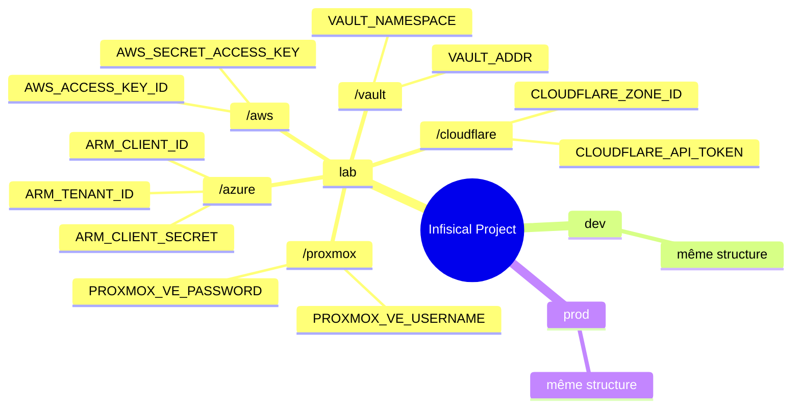
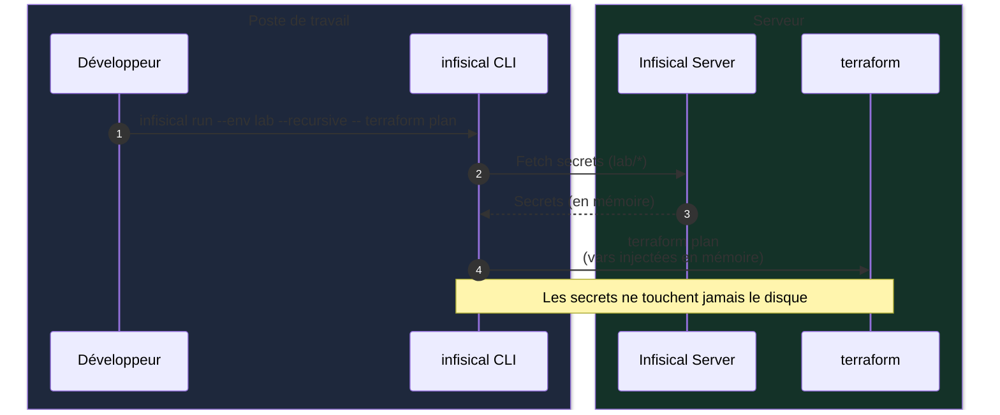
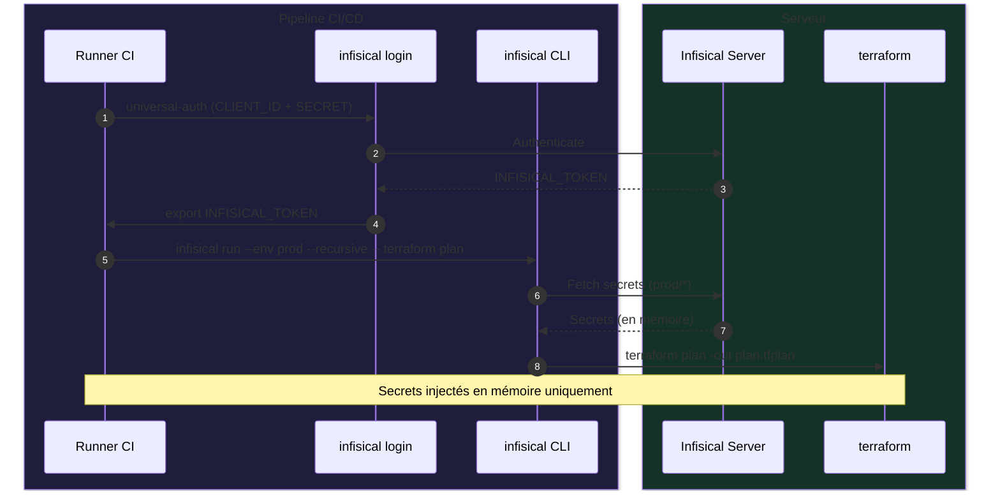
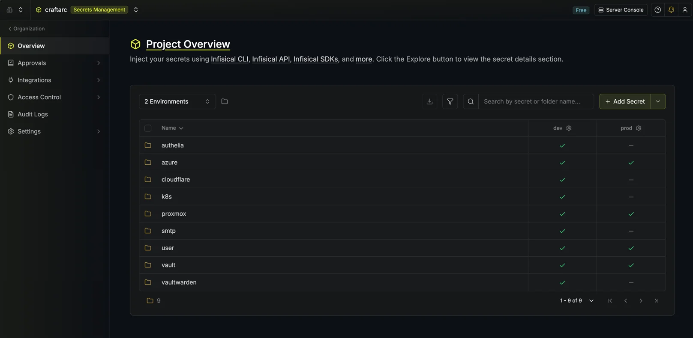

## Contexte

Entre les souscriptions `SaaS` et les services auto-hébergés, on accumule vite des secrets : identifiants, mot de passe, tokens (`Azure`, `AWS`, `Proxmox`, `Cloudflare` ) ... Chaque outil IaC en a besoin pour s'authentifier et interagir avec les API.

La solution classique : des fichiers `.envrc/.env` ignorés par git, chargés automatiquement par [direnv](https://direnv.net/). Pratique sur un seul poste.
Dès que vous avez deux laptops, une dizaine de `VMs Proxmox` et des pipelines `CI/CD`, ça dérape. Autant de postes où le `.envrc` diverge en silence.

> J'ai des pre-commits qui scannent chaque fichier modifié pour éviter les fuites accidentelles. Ça aide, mais ça ne règle pas le fond du problème.
> {: .prompt-info }

```bash
# .envrc typique qui finit par ressembler à ça
export ARM_TENANT_ID="..."
export VAULT_TOKEN="..."
export PROXMOX_VE_PASSWORD="..."
export CLOUDFLARE_API_TOKEN="..."
export AWS_ACCESS_KEY_ID="..."
export AWS_SECRET_ACCESS_KEY="..."
# ... 30 autres variables
```

J'ai migré vers [Infisical](https://infisical.com), un gestionnaire de secrets open-source auto-hébergé, pour avoir une seule source de vérité sur tous mes postes et CI/CD.

## Objectif

Après lecture, vous saurez :

- Pourquoi `direnv` atteint ses limites dès qu'on dépasse un seul poste
- Pourquoi j'ai choisi `Infisical` plutôt que `OpenBao` directement (que j'utilise déjà pour d'autres usages)
- Comment l'intégration fonctionne avec `Terraform` et les pipelines Gitea Actions / GitHub Actions
- Ce que ça donne concrètement au quotidien

> Cet article n'est pas un tutoriel d'installation d'Infisical pas-à-pas. C'est un retour sur la migration et l'architecture qui en résulte.
> {: .prompt-info }

## Le problème avec direnv

### Ce que direnv fait très bien

[direnv](https://direnv.net/) est un outil bien pensé. Il intercepte le changement de répertoire dans votre shell, charge le `.envrc` présent, et le décharge quand vous en sortez.
Pas de serveur, pas de service, juste votre shell.

```bash
# Après un simple `direnv allow .`
cd votre-projet-terraform #example
# ✅ Toutes les vars sont automatiquement chargées
terraform plan

cd ../..
# ✅ Les vars sont automatiquement déchargées
```

Propre, léger, zéro friction pour un développeur seul sur un seul poste.

### Là où ça se complique

La réalité de mon monorepo `mon-super-project-monorepo` avant la migration :

```
root/
├── ~/.envrc                          # Vars globales (ex: ARM_*, VAULT_*)
├── iac/
│   ├── terraform/.envrc              # Vars Terraform (ARM_*, PROXMOX_*, etc.)
│   └── ansible/.envrc                # Template (le vrai n'est pas versionné)
```

Problèmes concrets :

- **Duplication** : les mêmes vars `ARM_*` vivent dans `~/.envrc` et dans `iac/terraform/.envrc`. Changer une valeur = l'`update` à plusieurs endroits.
- **Pas portable** : mon `.envrc` principal vit sur mon laptop. Sur les autres postes, j'ai des fichiers différents, souvent en retard.
- **CI/CD aveugle** : Gitea Actions et GitHub Actions ne savent pas ce qu'est un `.envrc`. Il faut un mécanisme entièrement différent pour les secrets en CI.
- **Secrets sur disque** : même gitignorés, les secrets restent en clair dans des fichiers texte locaux. Les agents AI y ont souvent accès. Un mauvais `.gitignore` et c'est la catastrophe.
- **Pas d'environnements** : un seul `.envrc` pour `lab`, `dev` et `prod`, donc on commente, décommente, ou on maintient plusieurs fichiers.

> Un `.envrc` gitignored reste un secret en clair sur le disque. Si votre poste est compromis, vos secrets le sont aussi.
> {: .prompt-warning }

### Le raccourci que j'avais essayé avant

Avant d'aller vers Infisical, j'avais ajouté des recettes `justfile` de plus en plus complexes à mon task runner `just` pour charger le `.envrc` comme un `.env`, ou le sourcer manuellement dans chaque commande.
Ça fonctionne en local, mais ça ne règle pas la synchronisation multi-postes (oui il y a des outilis comme `syncthing` qui font ça mais secrets reste en claire sur le disque), pas d'intégration CI/CD, pas de gestion par environnement, pas d'audit.
Un task runner automatise des tâches, il ne gère pas des secrets.

> Quand vos recettes deviennent complexes juste pour charger des secrets, c'est le signe qu'il faut un outil dédié.
> {: .prompt-tip }

## Pourquoi Infisical ?

### Présentation rapide

[Infisical](https://infisical.com) est une plateforme open-source de gestion de secrets. SaaS ou auto-hébergé dans mon cas, via une Ansible role et Docker Compose, ou Kubernetes.

Ce qui m'a convaincu :

| Critère                             | direnv    | HashiCorp Vault/Openbao                   | Infisical                            |
| ----------------------------------- | --------- | ----------------------------------------- | ------------------------------------ |
| Auto-hébergeable                    | ✅        | ✅                                        | ✅                                   |
| CLI simple                          | ✅        | ⚠️ complexe                               | ✅                                   |
| Injection automatique des vars envs | ❌        | ❌ agent un peu complexe                  | ✅ `infisical run -- votre commande` |
| Environnements (lab/dev/prod)       | ❌ manuel | ✅ Namespace pour bao, vault entreprise   | ✅ natif                             |
| Auth Machine Identity (CI)          | ❌        | ✅                                        | ✅ Universal Auth                    |
| Interface web + audit               | ❌        | ✅                                        | ✅                                   |
| Facilité de setup                   | ✅✅      | ⚠️                                        | ✅                                   |
| Open source                         | ✅        | ⚠️ BSL pour vault mais BAO est opensource | ✅ Apache 2                          |

J'utilise déjà `Vault/OpenBao` pour d'autres usages (PKI, dynamic secrets, external secrets k8s). Infisical s'intègre à côté sans conflit. Dans un autre article je couvrirai son intégration avec Kubernetes via l'opérateur Infisical/External Secrets.

> La machine identity d'Infisical (Universal Auth) est faite pour la CI/CD : un client ID + secret révocables individuellement, avec des permissions granulaires par pipeline.
> {: .prompt-info }

### Organisation des secrets dans Infisical

J'ai organisé mes secrets par dossiers fonctionnels, dans chaque environnement (lab, dev, prod) :



Un seul projet Infisical, trois contextes distincts. `infisical run --env lab` injecte les secrets du contexte `lab`, c'est tout.

## L'architecture après migration

Du poste de travail au pipeline CI/CD :






_Exemple de configuration_

La commande `infisical run` est identique sur mon laptop, sur les autres postes, et dans les pipelines. Zéro `.envrc` à synchroniser, zéro secret hardcodé.

## Migration en pratique

### Étape 1 : Auto-héberger Infisical avec Docker Compose

Infisical propose une [version cloud](https://app.infisical.com) si vous ne voulez pas gérer l'infrastructure. Pour mon homelab, je préfère l'auto-hébergement.

#### Structure du déploiement

Infisical tourne avec trois conteneurs :

| Conteneur         | Image                 | Rôle                               |
| ----------------- | --------------------- | ---------------------------------- |
| `infisical`       | `infisical/infisical` | Application principale (port 8080) |
| `infisical-db`    | `postgres:18-alpine`  | Base de données (secrets chiffrés) |
| `infisical-redis` | `redis:8-alpine`      | Cache et files de travaux          |

> Prévoyez au minimum 2 CPU, 4 Go de RAM et 20 Go de disque.
> {: .prompt-info }

#### Option rapide : [Docker Compose officiel](https://infisical.com/docs/self-hosting/deployment-options/docker-compose)

```bash
# Télécharger le compose officiel
curl -o docker-compose.prod.yml https://raw.githubusercontent.com/Infisical/infisical/main/docker-compose.prod.yml

# Télécharger le fichier .env d'exemple
curl -o .env https://raw.githubusercontent.com/Infisical/infisical/main/.env.example

# Protéger le fichier .env
chmod 600 .env
```

Editez le `.env` pour les variables critiques :

```bash
# Générer une clé de chiffrement (16 octets hex)
ENCRYPTION_KEY=$(openssl rand -hex 16)

# Générer un secret d'authentification (32 octets base64)
AUTH_SECRET=$(openssl rand -base64 32)

# URL d'accès à votre instance
SITE_URL=http://localhost:80 #par example mais si vous avez un nom de domaine pour votre homelab, mettez-le ici
```

> Ne committez jamais le fichier `.env`. Il contient la clé de chiffrement de tous vos secrets — sa perte rend les données irrécupérables même avec une restauration de la base.
> {: .prompt-warning }

```bash
docker compose -f docker-compose.prod.yml up -d

# Vérifier que les 3 conteneurs sont up
docker compose -f docker-compose.prod.yml ps

# Tester l'API
curl -s http://localhost:80/api/status
```

Le premier utilisateur à s'inscrire devient administrateur de l'instance.

### Étape 2 : Lier le projet avec `.infisical.json`

À la racine du repo, un fichier `.infisical.json` lie le dépôt au projet Infisical. La CLI le détecte automatiquement.

```json
{
  "workspaceId": "fa2768c4-0000-0000-0000-000000000000"
}
```

### Étape 3 : Migrer les secrets avec un script

J'ai écrit un script qui lit les variables depuis `~/.envrc` et les pousse dans Infisical par dossier et environnement :

```bash
# Préfixe de la variable → dossier Infisical
folder_for() {
  case "$1" in
    ARM_*|AZURE_*)  echo "/azure"      ;;
    VAULT_*)        echo "/vault"      ;;
    PROXMOX_*)      echo "/proxmox"    ;;
    CLOUDFLARE_*)   echo "/cloudflare" ;;
    CLUSTER_*)      echo "/cluster"    ;;
    *)              echo "/misc"       ;;
  esac
}

# Pousser dans les 3 environnements pour les vars communes
for var in ARM_TENANT_ID ARM_SUBSCRIPTION_ID ARM_CLIENT_ID ARM_CLIENT_SECRET; do
  for env in lab dev prod; do
    infisical secrets set "${var}=${!var}" \
      --env "${env}" \
      --path "$(folder_for ${var})" \
      --domain https://infisical.home.example.com
  done
done
```

Le script complet supporte `--dry-run`, `--env`, `--force` et gère la création des dossiers automatiquement.

### Étape 4 : Intégrer Infisical dans les recettes `just`

Plutôt que de préfixer chaque commande manuellement avec `infisical run ...`, j'utilise mon task runner [`just`](https://just.systems) un outil de gestion de tâches minimaliste inspiré de `make`, pour encapsuler cet appel une seule fois.
La syntaxe d'appel reste simple après :

```bash
just env=lab init  # initialise Terraform avec les secrets lab
just env=lab plan  # plan avec les secrets lab
just env=prod plan # plan avec les secrets prod
just env=dev apply # apply avec les secrets dev
```

Une variable `_infisical` construite une fois en tête du `justfile`, réutilisée dans chaque recette :

```shell
env := env_var_or_default("ENV", "lab")

# Préfixe commun à toutes les recettes sensibles
_infisical := "infisical run" \
    + " --env "       + env \
    + " --projectId fa2768c4-0000-0000-0000-000000000000" \
    + " --domain https://infisical.home.example.com" \
    + " --recursive --silent"

init:
    {{_infisical}} -- terraform init

plan:
    {{_infisical}} -- terraform plan \
        -var-file=variables/common.tfvars \
        -var-file=variables/{{env}}.tfvars

apply:
    {{_infisical}} -- terraform apply \
        -var-file=variables/common.tfvars \
        -var-file=variables/{{env}}.tfvars
```

La variable `env` est passée en argument `just` : pas de `.envrc` à sourcer, pas d'export manuel. Les secrets sont injectés en mémoire uniquement le temps de la recette.

> L'option `--recursive` est importante : elle charge tous les secrets des sous-dossiers (`/azure`, `/vault`, `/proxmox`, etc.) en une seule invocation. Sans elle, seul le dossier racine est chargé.
> {: .prompt-warning }

### Étape 5 : Intégration CI/CD avec Universal Auth

Pour les pipelines, Infisical propose une authentification machine sans session interactive. J'ai créé deux composite actions réutilisables :

**Login** :

```yaml
# .ci/actions/infisical-login/action.yml
name: Infisical Login
runs:
  using: composite
  steps:
    - name: Authenticate
      shell: bash
      run: |
        token=$(infisical login --method=universal-auth --silent --plain)
        echo "INFISICAL_TOKEN=${token}" >> "$GITHUB_ENV"
```

**Utilisation dans un pipeline** :

```yaml
env:
  INFISICAL_API_URL: ${{ vars.INFISICAL_API_URL }}
  INFISICAL_UNIVERSAL_AUTH_CLIENT_ID: ${{ vars.INFISICAL_UNIVERSAL_AUTH_CLIENT_ID }}
  INFISICAL_UNIVERSAL_AUTH_CLIENT_SECRET: ${{ secrets.INFISICAL_UNIVERSAL_AUTH_CLIENT_SECRET }}

steps:
  - uses: actions/checkout@v4
  - uses: ./.ci/actions/infisical-login
  - name: Plan
    working-directory: iac/terraform
    run: |
      infisical run \
        --env prod \
        --projectId fa2768c4-0000-0000-0000-000000000000 \
        --recursive \
        -- terraform plan -out plan.tfplan
  - uses: ./.ci/actions/infisical-logout
    if: always()
```

En CI, 3 secrets suffisent (`API_URL`, `CLIENT_ID`, `CLIENT_SECRET`). Tous les autres (ARM, Proxmox, Vault, etc.) passent par Infisical — le pipeline ne les voit jamais directement.

> Moins de secrets dans les variables CI = moins de surface d'attaque. Avec Infisical, les secrets métier ne quittent jamais le serveur, sauf pour être injectés en mémoire dans le sous-processus.
> {: .prompt-tip }

## Ressources utiles

- [Infisical — Documentation officielle](https://infisical.com/docs)
- [Infisical CLI — Référence](https://infisical.com/docs/cli/overview)
- [direnv — Documentation](https://direnv.net/)
- [Infisical — Universal Auth (Machine Identity)](https://infisical.com/docs/documentation/platform/identities/universal-auth)
- [Infisical — Opérateur Kubernetes](https://infisical.com/docs/integrations/platforms/kubernetes)

## Conclusion

Ce que ça change concrètement :

- Nouveau laptop : `infisical login`, `just env=lab plan` — ça tourne immédiatement, sans copier de fichier
- Nouveau pipeline CI : 3 variables au lieu de 30, le reste vient d'Infisical
- Rotation d'un secret : une seule modification dans l'interface, propagée partout

Les secrets n'existent qu'en mémoire le temps de l'exécution. Rien sur le disque, rien dans les logs.

Ansible et Kubernetes suivront la même logique. La mécanique est identique — c'est juste une question de temps.

> Si vous gérez plusieurs outils IaC sur plusieurs postes, la question n'est pas "si" vous devriez centraliser vos secrets, mais "quand".
> {: .prompt-tip }

Et vous, comment gérez-vous vos secrets IaC en homelab ? Partagez votre expérience en commentaires !
