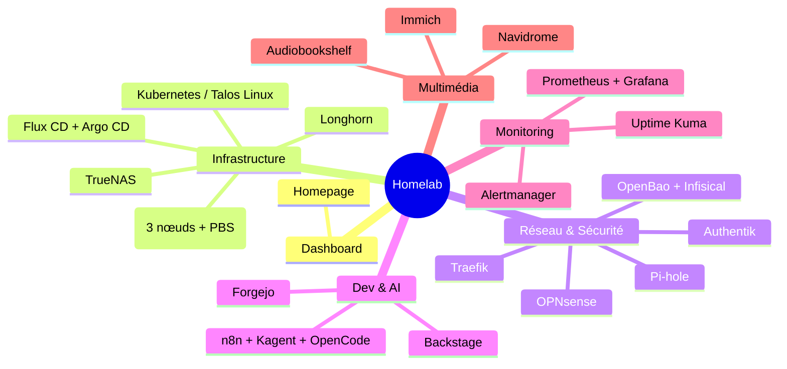

## Contexte

Je suis convaincu que le meilleur moyen d'apprendre l'infrastructure, c'est d'en construire une. C'est exactement la philosophie de mon Homelab : appliquer à la maison ce que je fais en entreprise, avec des outils open-source, pour tester, casser et réparer.

Au fil du temps, la liste des services s'est structurée en couches bien distinctes : infrastructure, réseau & sécurité, développement, monitoring et multimédia. Et un jour, j'ai réalisé qu'il me fallait un point d'entrée unique pour tout piloter. Alors j'ai testé plusieurs solutions avant de choisir [Homepage](https://gethomepage.dev/) comme mon dashboard central.

> Mon Homelab n'est pas un serveur "qui tourne dans un coin". Tout est versionné dans mon monorepo que je vais opensource bientôt, provisionné avec `Terraform/OpenTofu` et `Ansible`, et déployé en GitOps avec `Flux CD`.
> {: .prompt-info }

## Objectif

Dans cet article, je vous propose une visite guidée de mon Homelab. Après lecture, vous saurez :

- Comment l'infrastructure est organisée (virtualisation, Kubernetes, GitOps)
- Quels outils réseau, sécurité et développement je self-héberge, et dans quel but
- Quelle stack d'observabilité j'utilise pour tout surveiller
- Comment tous ces services sont exposés et sécurisés

Ce n'est pas un tutoriel pas-à-pas, c'est un tour d'horizon : une photo de ce que je roule concrètement, avec les liens utiles pour approfondir chaque outil.

## Une vue d'ensemble

Avant d'entrer dans le détail, voici comment s'organise mon Homelab :

## Le point d'entrée : Homepage

[Homepage](https://gethomepage.dev/) est un dashboard self-hosté, léger et entièrement configurable en `YAML`. C'est la porte d'entrée de tout mon Homelab.

Il me permet de :

- Regrouper tous mes services par onglets : `Infrastructure`, `Network & Security`, `Dev & AI`, `Monitoring`, `Multimédia`, `External Services`
- Afficher des widgets en temps réel : ressources CPU/mémoire/disque, date, recherche
- Accéder à chaque service en un clic, avec le statut de disponibilité

## Infrastructure

### La virtualisation : Proxmox VE

[Proxmox VE](https://www.proxmox.com/) est la base de mon Homelab. Un cluster de cinq nœuds dont trois sont permanents et actifs en permanence (PVE1, PVE2, PVE3), avec un [Proxmox Backup Server](https://www.proxmox.com/en/proxmox-backup-server) dédié aux sauvegardes.

Les deux nœuds restants sont démarrés à la demande : une `CronJob` Kubernetes envoie un `Wake-on-LAN` (WoL) pour les réveiller quand j'en ai besoin, et une autre les éteint automatiquement via un schedule. Objectif : économiser la consommation électrique quand la charge ne les justifie pas.

Tout le provisioning est fait en `Infrastructure-as-Code` avec `Terraform/OpenTofu`, et la configuration avec `Ansible`.

### Le système du cluster : Talos Linux

Au-dessus de Proxmox, mon cluster [Kubernetes](https://kubernetes.io/) tourne sur [Talos Linux](https://www.talos.dev/), une distribution immutable conçue exclusivement pour Kubernetes.

### Le GitOps : Flux CD et Argo CD

Pour appliquer les changements, j'utilise le GitOps : [Flux CD](https://fluxcd.io/) réconcilie l'état du cluster avec ce qui est déclaré dans mes dépôts git. Un `git push` suffit pour déployer, aucune commande `kubectl apply` à la main. J'utilise aussi [Argo CD](https://argoproj.github.io/cd/), mais plutôt pour garder la main sur le cluster et faire quelques petites expériences.

Autour de ça, j'ai aussi :

- [Headlamp](https://headlamp.dev/) : une UI moderne pour inspecter le cluster
- [Flux Web](https://github.com/controlplaneio-fluxcd/flux-web) : l'interface web de Flux CD pour visualiser les réconciliations
- [AKHQ](https://akhq.io/) : l'interface de pilotage de mon cluster Kafka, déployé avec l'opérateur [Strimzi](https://strimzi.io/)

### Le stockage : TrueNAS, Longhorn, RustFS

Le stockage est organisé en plusieurs niveaux :

- [TrueNAS](https://www.truenas.com/) pour le stockage réseau classique
- [Longhorn](https://longhorn.io/) comme stockage distribué natif Kubernetes
- [RustFS](https://rustfs.io/), un stockage objet compatible `S3`, décliné en deux pools — un rapide et un lent — selon l'usage des applications

Et [PgAdmin](https://www.pgadmin.org/) pour administrer les bases `PostgreSQL`.

## Réseau & Sécurité

### Le réseau : OPNsense, routeurs, Traefik

En basse couche, le réseau est protégé par un pare-feu [OPNsense](https://opnsense.org/), complété par deux routeurs. Pour exposer les services, [Traefik](https://traefik.io/) fait office de reverse proxy et de load balancer.

Le DNS est géré par [Pi-hole](https://pi-hole.net/), que j'utilise aussi comme bloqueur de publicités au niveau du réseau.

### L'identité et le SSO : Authentik

[Authentik](https://goauthentik.io/) est mon Identity Provider. Il centralise le `SSO` de tous les services self-hébergés et gère les accès via un proxy OAuth. Un seul compte, une seule session, des politiques d'accès granulaires.

### Les mots de passe : Vaultwarden

[Vaultwarden](https://github.com/dani-garcia/vaultwarden), l'implémentation légère et open-source de Bitwarden, héberge mon gestionnaire de mots de passe. Synchronisation multi-appareils sans dépendre d'un service cloud.

### Les secrets : OpenBao et Infisical

Côté secrets, j'utilise deux outils complémentaires :

- [OpenBao](https://openbao.org/), le fork communautaire de `Vault`, pour le `PKI`, les secrets dynamiques et l'intégration avec Kubernetes via `External Secrets`
- [Infisical](https://infisical.com) pour la gestion des variables d'environnement de mes outils `IaC` (Terraform, Ansible) et de mes pipelines CI/CD

> Je détaille la migration de `direnv` vers `Infisical` dans mon article : [Plus de .envrc, infisical mon seul gestionnaire de secrets](https://mombe090.github.io/posts/migrating-envrc-to-infisical/).
> {: .prompt-info }

## Dev & AI

### Hebergement de code source et CI : Forgejo

[Forgejo](https://forgejo.org/) héberge mes dépôts git et mes pipelines CI/CD. C'est le cœur de mon workflow GitOps : toute la configuration du Homelab, y compris celle de Homepage, vit dans Forgejo.

### Le portail développeur : Backstage

[Backstage](https://backstage.io/) est mon developer portal. Il sert de catalogue de services : aujourd'hui avec l'AI qui capable de générer des composants, honetement je ne m'en sert pas.

### Les Feed RSS: 

J'ai vibecoder un application qui me permet de centraliser mes flux RSS, sans tracker ni algorithme. Un petit plaisir de liberté numérique au quotidien que lit quotidiennement pour suivre les dernières actualités.

### La documentation : MkDocs

[Mombedocs](https://docs.mombesoft.com/) est généré avec [Zensical](https://zensical.org/docs/get-started/). 

### L'IA : n8n, Kagent, OpenCode

Et bien sûr, la partie la plus récente et la plus amusante :

- [n8n](https://n8n.io/) pour automatiser mes workflows
- [Kagent](https://kagent.dev/), un agent IA intégré à Kubernetes pour l'exploitation du cluster
- [OpenCode](https://opencode.ai/), mon assistant de codage que j'utilise quotidiennement via l'option web que self-host.

> L'IA auto-hébergée est devenu un vrai sujet de mon Homelab : j'utilise au quotidien `OpenCode/Pi` pour coder et `Kagent` pour interagir avec mon cluster.
> {: .prompt-info }

## Monitoring

### La stack observabilité : Prometheus, Grafana, Alertmanager

Sans observabilité, on opère à l'aveugle. Ma stack est classique mais complète :

- [Prometheus](https://prometheus.io/) collecte les métriques
- [Grafana](https://grafana.com/) les visualise dans des dashboards
- [Alertmanager](https://prometheus.io/docs/alerting/latest/alertmanager/) route les alertes vers Discord.

### La supervision : Uptime Kuma

[Uptime Kuma](https://github.com/louislam/uptime-kuma) surveille la disponibilité de tous mes services, avec des notifications immédiates en cas de panne. C'est la couche "à l'extérieur du cluster" qui me dit si le reste fonctionne.

## Multimédia

### La musique : Navidrome

[Navidrome](https://www.navidrome.org/) me permet de streamer ma bibliothèque musicale en self-hosting, avec une interface moderne.

### Les photos : Immich

[Immich](https://immich.app/) est mon alternative à Google Photos : sauvegarde, recherche et reconnaissance automatique des photos, le tout chez moi.

### Les audiolivres : Audiobookshelf

[Audiobookshelf](https://www.audiobookshelf.org/) centralise ma bibliothèque d'audiolivres et de podcasts, synchronisée entre tous mes appareils.

## Ressources utiles

- [Homepage — Dashboard](https://gethomepage.dev/)
- [Proxmox VE](https://www.proxmox.com/)
- [Talos Linux](https://www.talos.dev/)
- [Flux CD](https://fluxcd.io/)
- [CraftArc — mon monorepo Homelab](https://github.com/mombe090)
- [Les autres articles du blog](https://mombe090.github.io/)

## Conclusion

Mon Homelab, ce n'est pas une liste de services empilés : c'est une architecture en couches, où chaque outil répond à un besoin et où chaque couche est déployée en GitOps. Le dashboard Homepage n'est que la partie visible d'un ensemble pensé comme un environnement professionnel.

Commencer petit et structurer progressivement est la clé : j'ai commencé avec un simple serveur avec du docker puis j'ai graduellement tout migré vers kubernetes, et chaque service ajouté a enrichi l'ensemble sans jamais le rendre ingérable.
