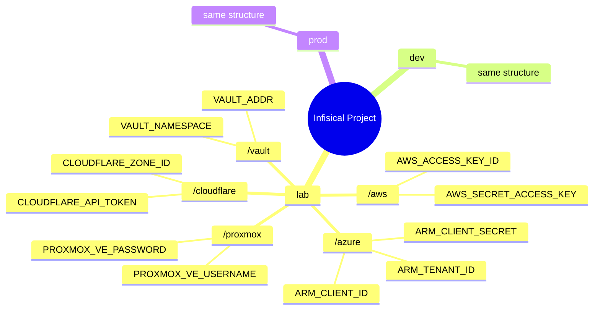
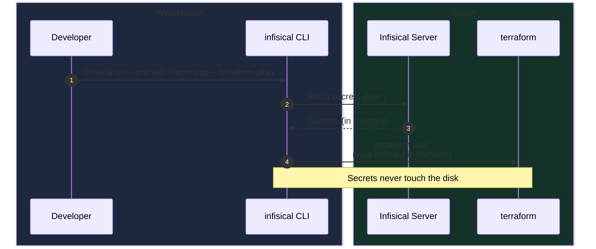
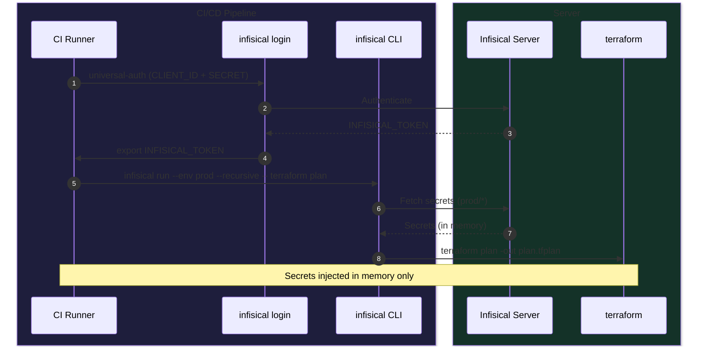

## Context

Between `SaaS` subscriptions and self-hosted services, secrets pile up fast: credentials, passwords, tokens (`Azure`, `AWS`, `Proxmox`, `Cloudflare`)... Every IaC tool needs them to authenticate and talk to APIs.

The classic answer: gitignored `.envrc/.env` files, loaded automatically by [direnv](https://direnv.net/). Works fine on one machine.
Once you have two laptops, a dozen `Proxmox VMs`, and a set of `CI/CD` pipelines, things fall apart. Each machine where the `.envrc` silently drifts out of sync.

> I run pre-commit hooks that scan every changed file for accidental leaks. Useful, but it does not fix the underlying problem.
> {: .prompt-info }

```bash
# A .envrc that ends up looking like this
export ARM_TENANT_ID="..."
export VAULT_TOKEN="..."
export PROXMOX_VE_PASSWORD="..."
export CLOUDFLARE_API_TOKEN="..."
export AWS_ACCESS_KEY_ID="..."
export AWS_SECRET_ACCESS_KEY="..."
# ... 30 more variables
```

I migrated to [Infisical](https://infisical.com), a self-hosted open-source secret manager, to have one source of truth — across all my machines and in CI/CD.

## Goal

After reading this, you will know:

- Why `direnv` breaks down the moment you go beyond a single machine
- Why I picked `Infisical` over `OpenBao` directly (which I already use for other things)
- How the integration works with `Terraform` and Gitea Actions / GitHub Actions pipelines
- What it actually looks like day to day

> This is not a step-by-step Infisical installation guide. It is a migration experience report.
> {: .prompt-info }

## The Problem with direnv

### Where direnv shines

[direnv](https://direnv.net/) is a well-designed tool. It hooks into your shell's directory change, loads the `.envrc` file if one is present, and unloads it when you leave.
No server, no service — just your shell.

```bash
# After a simple `direnv allow .`
cd your-terraform-project # example
# ✅ All vars are automatically loaded
terraform plan

cd ../..
# ✅ All vars are automatically unloaded
```

Clean, lightweight, zero friction for a single developer on a single machine.

### Where it breaks down

My `my-awesome-monorepo` before the migration:

```
root/
├── ~/.envrc                          # Global vars (ARM_*, VAULT_*, ...)
├── iac/
│   ├── terraform/.envrc              # Terraform vars (ARM_*, PROXMOX_*, ...)
│   └── ansible/.envrc                # Template (the real one is not versioned)
```

Concrete problems:

- **Duplication**: the same `ARM_*` variables live in `~/.envrc` and in `iac/terraform/.envrc`. Change one value = update it in multiple places.
- **Not portable**: my main `.envrc` lives on my primary laptop. On the other machines I have different files, often outdated.
- **CI/CD blind spot**: Gitea Actions and GitHub Actions have no concept of `.envrc`. You need a completely separate mechanism for secrets in CI.
- **Secrets on disk**: even gitignored, secrets sit in plaintext local files. AI agents often have access to these. A bad `.gitignore` entry and it is game over.
- **No environment separation**: one `.envrc` for `lab`, `dev`, and `prod` — you end up commenting, uncommenting, or maintaining multiple files.

> A gitignored `.envrc` is still plaintext on disk. If your machine is compromised, so are your secrets.
> {: .prompt-warning }

### The workaround I tried first

Before Infisical, I added increasingly complex recipes to my task runner `just` — loading the `.envrc` as a `.env` file, or sourcing it manually inside each shell command.
That works locally, but solves nothing: no multi-machine sync (yes, tools like `syncthing` exist but secrets are still plaintext on disk), no CI/CD integration, no per-environment management, no audit trail. A task runner automates tasks; it does not manage secrets.

> When your recipes get complicated just to load secrets, that is a sign you need a dedicated tool.
> {: .prompt-tip }

## Why Infisical?

### Quick overview

[Infisical](https://infisical.com) is an open-source secret management platform. SaaS or self-hosted — in my case, via an Ansible role and Docker Compose, or Kubernetes.

What pushed me toward it:

| Criteria                    | direnv    | HashiCorp Vault/Openbao                  | Infisical                          |
| --------------------------- | --------- | ---------------------------------------- | ---------------------------------- |
| Self-hostable               | ✅        | ✅                                       | ✅                                 |
| Simple CLI                  | ✅        | ⚠️ complex                               | ✅                                 |
| Subprocess env injection    | ❌        | ❌ agent somewhat complex                | ✅ `infisical run -- your command` |
| Environments (lab/dev/prod) | ❌ manual | ✅ Namespaces for Bao, Vault enterprise  | ✅ native                          |
| Machine Auth (CI)           | ❌        | ✅                                       | ✅ Universal Auth                  |
| Web UI + audit log          | ❌        | ✅                                       | ✅                                 |
| Setup ease                  | ✅✅      | ⚠️                                       | ✅                                 |
| Open source                 | ✅        | ⚠️ BSL for Vault, but Bao is open source | ✅ Apache 2                        |

I already use `Vault/OpenBao` for other purposes (PKI, dynamic secrets, external secrets k8s). Infisical sits alongside it without conflict. In another article I will cover the Kubernetes integration via the Infisical/External Secrets operator.

> Infisical's machine identity (Universal Auth) is built for CI/CD: a client ID + secret you can revoke individually, with per-pipeline granular permissions.
> {: .prompt-info }

### How secrets are organized in Infisical

I grouped secrets into functional folders, inside each environment (lab, dev, prod):




_Configuration Sample_

One Infisical project, three distinct contexts. `infisical run --env lab` injects the `lab` secrets — that is it.

## Architecture after migration

Workstation to CI/CD pipeline:





The `infisical run` command is identical on my laptop, on the other machines, and inside pipelines. No `.envrc` to sync, no hardcoded secrets.

## Migration in practice

### Step 1: Self-host Infisical with Docker Compose

Infisical offers a [cloud version](https://app.infisical.com) if you do not want to manage the infrastructure. For my homelab, I self-host.

#### Deployment structure

Infisical runs as three containers:

| Container         | Image                 | Role                         |
| ----------------- | --------------------- | ---------------------------- |
| `infisical`       | `infisical/infisical` | Main application (port 8080) |
| `infisical-db`    | `postgres:18-alpine`  | Database (encrypted secrets) |
| `infisical-redis` | `redis:8-alpine`      | Cache and job queues         |

> Plan for at least 2 CPU cores, 4 GB RAM, and 20 GB disk.
> {: .prompt-info }

#### Quick option: [official Docker Compose](https://infisical.com/docs/self-hosting/deployment-options/docker-compose)

```bash
# Download the official compose file
curl -o docker-compose.prod.yml https://raw.githubusercontent.com/Infisical/infisical/main/docker-compose.prod.yml

# Download the example .env file
curl -o .env https://raw.githubusercontent.com/Infisical/infisical/main/.env.example

# Protect the .env file
chmod 600 .env
```

Edit the `.env` for the critical variables:

```bash
# Generate an encryption key (16 bytes hex)
ENCRYPTION_KEY=$(openssl rand -hex 16)

# Generate an auth secret (32 bytes base64)
AUTH_SECRET=$(openssl rand -base64 32)

# URL of your instance
SITE_URL=http://localhost:80 # or your homelab domain if you have one
```

> Never commit the `.env` file. It holds the encryption key for all your secrets — lose it and the data is unrecoverable even with a database restore.
> {: .prompt-warning }

```bash
docker compose -f docker-compose.prod.yml up -d

# Verify all 3 containers are up
docker compose -f docker-compose.prod.yml ps

# Test the API
curl -s http://localhost:80/api/status
```

The first user to sign up becomes the instance administrator.

### Step 2: Bind the project with `.infisical.json`

At the root of the repo, a `.infisical.json` file ties the repository to the Infisical project. The CLI picks it up automatically.

```json
{
  "workspaceId": "fa2768c4-0000-0000-0000-000000000000"
}
```

### Step 3: Migrate secrets with a script

I wrote a script that reads variables from `~/.envrc` and pushes them into Infisical by folder and environment:

```bash
# Variable prefix → Infisical folder
folder_for() {
  case "$1" in
    ARM_*|AZURE_*)  echo "/azure"      ;;
    VAULT_*)        echo "/vault"      ;;
    PROXMOX_*)      echo "/proxmox"    ;;
    CLOUDFLARE_*)   echo "/cloudflare" ;;
    CLUSTER_*)      echo "/cluster"    ;;
    *)              echo "/misc"       ;;
  esac
}

# Push common variables to all three environments
for var in ARM_TENANT_ID ARM_SUBSCRIPTION_ID ARM_CLIENT_ID ARM_CLIENT_SECRET; do
  for env in lab dev prod; do
    infisical secrets set "${var}=${!var}" \
      --env "${env}" \
      --path "$(folder_for ${var})" \
      --domain https://infisical.home.example.com
  done
done
```

The full script supports `--dry-run`, `--env`, `--force`, and handles folder creation automatically.

### Step 4: Integrate Infisical into `just` recipes

Rather than prefixing every command manually with `infisical run ...`, I use my task runner [`just`](https://just.systems) — a minimalist task management tool inspired by `make`, without its pitfalls — to encapsulate the call once.
The invocation stays simple after that:

```bash
just env=lab init  # initialize Terraform with lab secrets
just env=lab plan  # plan with lab secrets
just env=prod plan # plan with prod secrets
just env=dev apply # apply with dev secrets
```

A `_infisical` variable built once at the top of the `justfile`, reused in every recipe:

```shell
env := env_var_or_default("ENV", "lab")

# Common prefix for all secret-aware recipes
_infisical := "infisical run" \
    + " --env "       + env \
    + " --projectId fa2768c4-0000-0000-0000-000000000000" \
    + " --domain https://infisical.home.example.com" \
    + " --recursive --silent"

init:
    {{_infisical}} -- terraform init

plan:
    {{_infisical}} -- terraform plan \
        -var-file=variables/common.tfvars \
        -var-file=variables/{{env}}.tfvars

apply:
    {{_infisical}} -- terraform apply \
        -var-file=variables/common.tfvars \
        -var-file=variables/{{env}}.tfvars
```

The `env` variable is passed as a `just` argument: no `.envrc` to source, no manual export. Secrets are injected in-memory only for the duration of the recipe.

> The `--recursive` flag is important: it loads secrets from all sub-folders (`/azure`, `/vault`, `/proxmox`, etc.) in a single call. Without it, only the root folder is loaded.
> {: .prompt-warning }

### Step 5: CI/CD integration with Universal Auth

For pipelines, Infisical provides machine authentication with no interactive session. I created two reusable composite actions:

**Login**:

```yaml
# .ci/actions/infisical-login/action.yml
name: Infisical Login
runs:
  using: composite
  steps:
    - name: Authenticate
      shell: bash
      run: |
        token=$(infisical login --method=universal-auth --silent --plain)
        echo "INFISICAL_TOKEN=${token}" >> "$GITHUB_ENV"
```

**Usage in a pipeline**:

```yaml
env:
  INFISICAL_API_URL: ${{ vars.INFISICAL_API_URL }}
  INFISICAL_UNIVERSAL_AUTH_CLIENT_ID: ${{ vars.INFISICAL_UNIVERSAL_AUTH_CLIENT_ID }}
  INFISICAL_UNIVERSAL_AUTH_CLIENT_SECRET: ${{ secrets.INFISICAL_UNIVERSAL_AUTH_CLIENT_SECRET }}

steps:
  - uses: actions/checkout@v4
  - uses: ./.ci/actions/infisical-login
  - name: Plan
    working-directory: iac/terraform
    run: |
      infisical run \
        --env prod \
        --projectId fa2768c4-0000-0000-0000-000000000000 \
        --recursive \
        -- terraform plan -out plan.tfplan
  - uses: ./.ci/actions/infisical-logout
    if: always()
```

In CI, 3 secrets are enough (`API_URL`, `CLIENT_ID`, `CLIENT_SECRET`). Everything else (ARM, Proxmox, Vault, etc.) goes through Infisical — the pipeline never sees them directly.

> Fewer secrets in CI variables means fewer ways for things to go wrong. With Infisical, business secrets never leave the server, except when injected in-memory into the subprocess.
> {: .prompt-tip }

## Useful resources

- [Infisical — Official documentation](https://infisical.com/docs)
- [Infisical CLI — Reference](https://infisical.com/docs/cli/overview)
- [direnv — Documentation](https://direnv.net/)
- [Infisical — Universal Auth (Machine Identity)](https://infisical.com/docs/documentation/platform/identities/universal-auth)
- [Infisical — Kubernetes Operator](https://infisical.com/docs/integrations/platforms/kubernetes)

## Conclusion

What changed day to day:

- New laptop: `infisical login`, `just env=lab plan` — works immediately, nothing to copy
- New CI pipeline: 3 variables instead of 30, the rest comes from Infisical
- Rotating a secret: one change in the UI, propagated everywhere

Secrets exist in memory only, for the duration of the subprocess. Nothing on disk, nothing in logs.

Ansible and Kubernetes are next. The mechanics are the same — just a matter of time.

> If you manage multiple IaC tools across multiple machines, the question is not whether to centralize your secrets, but when.
> {: .prompt-tip }

How do you manage your IaC secrets in your homelab? Share your experience in the comments!
