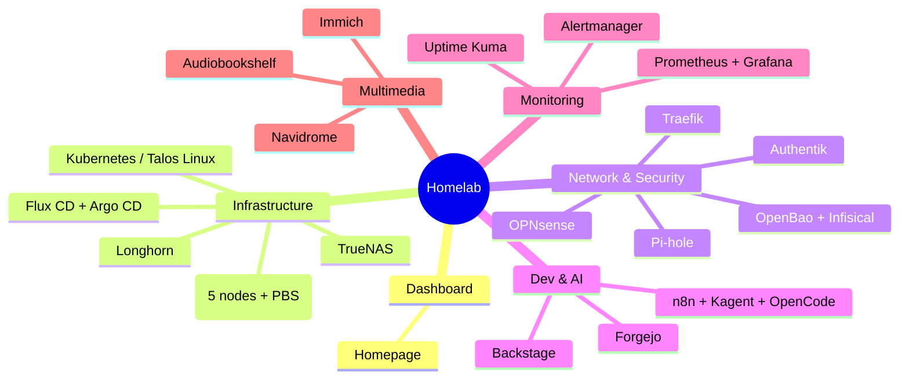

## Context

I firmly believe the best way to learn infrastructure is to build one. That is exactly the philosophy of my Homelab: apply at home what I do at work, with open-source tools, to test, break and fix things.

Over time, my list of services organized itself into clear layers: infrastructure, network & security, development, monitoring and multimedia. And one day I realized I needed a single entry point to manage it all. So I tried several solutions before choosing [Homepage](https://gethomepage.dev/) as my central dashboard.

> My Homelab is not a server "sitting in a corner". Everything is versioned in my monorepo, which I will open-source soon, provisioned with `Terraform/OpenTofu` and `Ansible`, and deployed with GitOps using `Flux CD`.
> {: .prompt-info }

## Objective

In this article, I take you on a guided tour of my Homelab. After reading, you will know:

- How the infrastructure is organized (virtualization, Kubernetes, GitOps)
- Which network, security and development tools I self-host, and why
- Which observability stack I use to monitor everything
- How all these services are exposed and secured

This is an overview, not a step-by-step tutorial: a snapshot of what I actually run, with useful links to go deeper on each tool.

## An Overview

Before diving into the details, here is how my Homelab is organized:

## The Entry Point: Homepage

[Homepage](https://gethomepage.dev/) is a self-hosted, lightweight dashboard, fully configurable in `YAML`. It is the front door to my entire Homelab.

It lets me:

- Group all my services into tabs: `Infrastructure`, `Network & Security`, `Dev & AI`, `Monitoring`, `Multimedia`, `External Services`
- Display real-time widgets: CPU/memory/disk resources, date, search
- Reach any service in one click, with availability status

## Infrastructure

### Virtualization: Proxmox VE

[Proxmox VE](https://www.proxmox.com/) is the foundation of my Homelab. A five-node cluster where three nodes run permanently (PVE1, PVE2, PVE3), with a dedicated [Proxmox Backup Server](https://www.proxmox.com/en/proxmox-backup-server) for backups.

The two remaining nodes start on demand: a Kubernetes `CronJob` sends a `Wake-on-LAN` (WoL) packet to wake them up when needed, and another shuts them down on a schedule. The goal: save electricity when the workload does not justify running them.

All provisioning is done as `Infrastructure-as-Code` with `Terraform/OpenTofu`, and configuration with `Ansible`.

### The Cluster OS: Talos Linux

On top of Proxmox, my [Kubernetes](https://kubernetes.io/) cluster runs on [Talos Linux](https://www.talos.dev/), an immutable distribution designed exclusively for Kubernetes.

### GitOps: Flux CD and Argo CD

To apply changes, I use GitOps: [Flux CD](https://fluxcd.io/) reconciles the cluster state with what is declared in my git repositories. A `git push` is enough to deploy. No manual `kubectl apply` needed. I also use [Argo CD](https://argoproj.github.io/cd/), but mainly to keep a hand on the cluster and run a few small experiments.

Around that, I also run:

- [Headlamp](https://headlamp.dev/): a modern UI to inspect the cluster
- [Flux Web](https://github.com/controlplaneio-fluxcd/flux-web): the Flux CD web UI to visualize reconciliations
- [AKHQ](https://akhq.io/): the control interface for my Kafka cluster, deployed with the [Strimzi](https://strimzi.io/) operator

### Storage: TrueNAS, Longhorn, RustFS

Storage is organized in several tiers:

- [TrueNAS](https://www.truenas.com/) for classic network storage
- [Longhorn](https://longhorn.io/) as Kubernetes-native distributed storage
- [RustFS](https://rustfs.io/), an `S3`-compatible object storage, split into two pools, a fast one and a slow one, depending on the use case

And [PgAdmin](https://www.pgadmin.org/) to administer the `PostgreSQL` databases.

## Network & Security

### The Network: OPNsense, routers, Traefik

At the lower layer, the network is protected by an [OPNsense](https://opnsense.org/) firewall, completed by two routers. To expose services, [Traefik](https://traefik.io/) acts as reverse proxy and load balancer.

DNS is handled by [Pi-hole](https://pi-hole.net/), which I also use as an ad blocker at the network level.

### Identity and SSO: Authentik

[Authentik](https://goauthentik.io/) is my Identity Provider. It centralizes the `SSO` of every self-hosted service and handles access through an OAuth proxy. One account, one session, granular access policies.

### Passwords: Vaultwarden

[Vaultwarden](https://github.com/dani-garcia/vaultwarden), the lightweight open-source implementation of Bitwarden, hosts my password manager. Multi-device sync without depending on a cloud service.

### Secrets: OpenBao and Infisical

On the secrets side, I use two complementary tools:

- [OpenBao](https://openbao.org/), the community fork of `Vault`, for `PKI`, dynamic secrets and Kubernetes integration through `External Secrets`
- [Infisical](https://infisical.com) for managing environment variables of my `IaC` tools (Terraform, Ansible) and my CI/CD pipelines

> I detail the migration from `direnv` to `Infisical` in my article: [Goodbye .envrc, Hello Infisical: One Secret Manager for My Entire Setup](https://mombe090.github.io/posts/migrating-envrc-to-infisical/).
> {: .prompt-info }

## Dev & AI

### Source Code Hosting and CI: Forgejo

[Forgejo](https://forgejo.org/) hosts my git repositories and CI/CD pipelines. It is the heart of my GitOps workflow: all the Homelab configuration, including Homepage's, lives in Forgejo.

### The Developer Portal: Backstage

[Backstage](https://backstage.io/) is my developer portal. It acts as a service catalog: nowadays, with AI able to generate components, honestly I don't use it.

### RSS Feeds

I vibecoded an application that lets me centralize my RSS feeds, without trackers or algorithms. A small bit of digital freedom that I read daily to keep up with the latest news.

### Documentation: Mombedocs

[Mombedocs](https://docs.mombesoft.com/) is generated with [Zensical](https://zensical.org/docs/get-started/).

### AI: n8n, Kagent, OpenCode

And of course, the most recent and most fun part:

- [n8n](https://n8n.io/) to automate my workflows
- [Kagent](https://kagent.dev/), a Kubernetes-integrated AI agent for cluster operations
- [OpenCode](https://opencode.ai/), my coding assistant which I use daily through the self-hosted web option

> Self-hosted AI has become a real topic in my Homelab: I use `OpenCode/Pi` daily for coding and `Kagent` to interact with my cluster.
> {: .prompt-info }

## Monitoring

### The Observability Stack: Prometheus, Grafana, Alertmanager

Without observability, you operate blind. My stack is classic but complete:

- [Prometheus](https://prometheus.io/) collects metrics
- [Grafana](https://grafana.com/) visualizes them in dashboards
- [Alertmanager](https://prometheus.io/docs/alerting/latest/alertmanager/) routes alerts to Discord

### Supervision: Uptime Kuma

[Uptime Kuma](https://github.com/louislam/uptime-kuma) monitors the availability of all my services, with immediate notifications on failure. It is the "outside the cluster" layer that tells me whether the rest is working.

## Multimedia

### Music: Navidrome

[Navidrome](https://www.navidrome.org/) lets me stream my music library in self-hosting, with a modern interface.

### Photos: Immich

[Immich](https://immich.app/) is my Google Photos alternative: backup, search and automatic photo recognition, all on my own hardware.

### Audiobooks: Audiobookshelf

[Audiobookshelf](https://www.audiobookshelf.org/) centralizes my audiobook and podcast library, synchronized across all my devices.

## Useful Resources

- [Homepage — Dashboard](https://gethomepage.dev/)
- [Proxmox VE](https://www.proxmox.com/)
- [Talos Linux](https://www.talos.dev/)
- [Flux CD](https://fluxcd.io/)
- [CraftArc — my Homelab monorepo](https://github.com/mombe090)
- [Other blog articles](https://mombe090.github.io/)

## Conclusion

My Homelab is a layered architecture, not a pile of services: every tool answers a need and every layer is deployed with GitOps. The Homepage dashboard is only the visible part of a setup designed like a professional environment.

I started small, with a single server running Docker, then gradually moved everything to Kubernetes. Every service I added enriched the whole without ever making it unmanageable.
